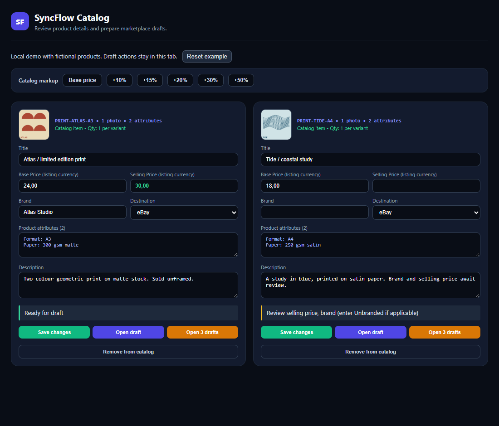

# SyncFlow Cross-Lister

A Chrome extension for sellers who reuse product listings across marketplaces. Capture the source once, review the price and brand in a local catalog, and prepare a destination draft.

[Download the extension](https://github.com/amine312/syncflow-crosslister/releases/tag/v2.6.1) · [Roadmap](ROADMAP.md) · [Étude de cas](docs/etude-de-cas.pdf) · [Charte graphique](docs/charte-graphique.pdf)



## Run the catalog demo

With Node.js 20 or later, run the following command from the source folder and open the local URL printed in the terminal.

```sh
node demo/server.mjs
```

The demo uses the extension’s dashboard and two fictional art prints. Try opening the unfinished Tide draft, enter a brand and a selling price, save it, then reload. Apply a 10% markup to its base price of 18 and check that the result is 19.80. Choose Etsy and open the draft to preview the destination locally. **Reset example** restores both prints.

## Try the review workflow

1. Unpack the extension ZIP from the release, or download and unpack the repository. In Chrome, open `chrome://extensions`, enable **Developer mode**, choose **Load unpacked**, and select the folder containing `manifest.json`.
2. Open a product page you own or have permission to reuse and click SyncFlow. Check the title, brand, amount and currency against the source.
3. Choose **Save to DB** to keep a work in progress. In the catalog, clear the brand or selling price and read the review message on the card. A missing amount stays blank. An explicit zero stays zero.
4. Enter the confirmed values. For an item you have verified has no brand, enter **Unbranded**. Open a target draft and inspect the destination form before submitting it yourself.

The three-draft action opens eBay, Vinted and Etsy. Availability of fields depends on the marketplace, locale, account and category. Live seller workflows remain to be validated. Amounts are numeric and SyncFlow does not perform currency conversion. Records imported with an older version may already contain guesses. Recheck those values against their source before reuse.

## How the pieces fit

| Component | Responsibility |
| --- | --- |
| Popup and injected extractor | Read listing fields from the active page and allow edits before saving |
| Background service worker | Coordinate extraction, the optional loopback parser, and listing images |
| Catalog and review rules | Store drafts in Chrome local storage, edit attributes and apply markups |
| Marketplace content scripts | Assist form entry when the recently requested destination matches |

The extension requests broad host access for product media. Opening the popup on an HTTP(S) page can send up to 250,000 characters of its HTML to the optional local parser. Use it on product pages. The parser listens on `127.0.0.1:8765`; the extension can run without it.

## Optional Python parser

Using Python 3.12 in a virtual environment, run the following commands from the repository root.

```sh
python -m pip install -r scrapling_backend/requirements.txt
python scrapling_backend/scrapling_server.py
```

Scrapling is an external dependency. The included server parses the HTML supplied by the extension.

## Validation and project notes

Run the offline regression suite from the root with Node 20 or later.

```sh
node --test tests/catalog.test.cjs
```

The browser workflow was exercised in Chrome against the local demo, using real DOM controls, a local storage adapter and a simulated destination. To repeat it with Chrome installed, install `playwright-core` locally and run `node demo/verify.cjs`. The optional Python parser was checked with missing product data and an explicit zero price. Live marketplace validation is tracked in the roadmap.

- [Roadmap and acceptance criteria](ROADMAP.md)
- [Étude de cas · décisions et validation (PDF)](docs/etude-de-cas.pdf)
- [Charte graphique · couleurs, typographie et composants (PDF)](docs/charte-graphique.pdf)
